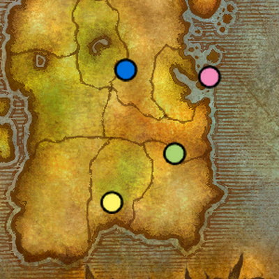

# WhereAreMyFriends

Shows your friends on the world map and the minimap, as long as they run WhereAreMyFriends too.  
WhereAreMyFriends finds out on its own which of your online friends run it. There is nothing to set up.  
Friends in your party or raid get no pin, because the game already shows them.

Type `/wamf` to open the settings.

To see guild members instead, use GuildMap.
